# 📦 RetailOps Cloud-Native Platform

A cloud-native retail integration system for SmartRetail Inc. It tracks stock in real time, automatically raises reorder events when inventory runs low, and is observable end to end with Azure Application Insights.

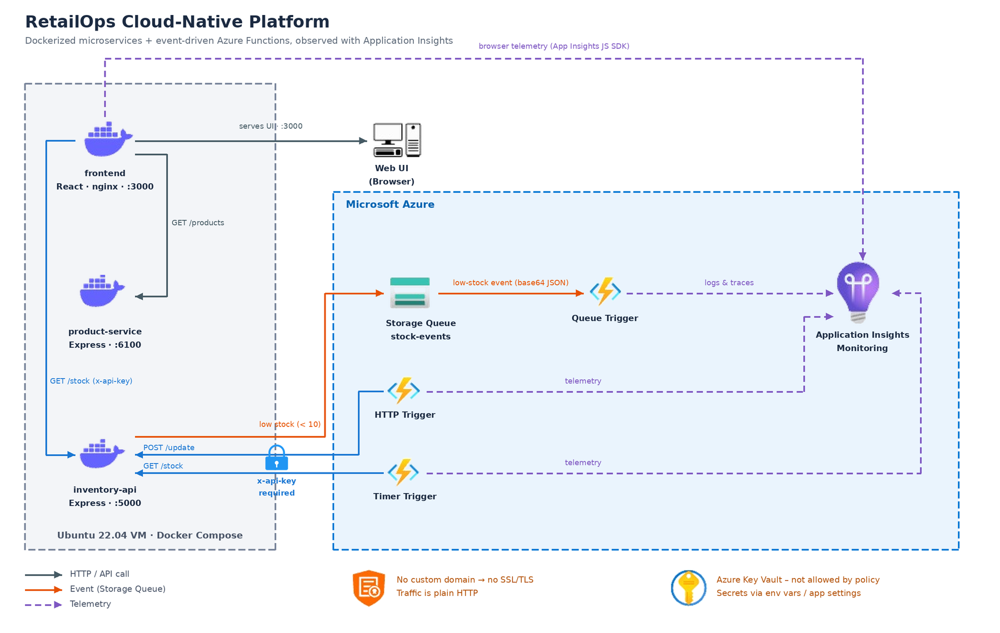

> Editable source: [`docs/architecture.drawio`](docs/architecture.drawio) — open it at [app.diagrams.net](https://app.diagrams.net) or in the draw.io desktop app. Logos are embedded in the file, so it renders anywhere.

---

## 🧠 System overview

| Layer | Component | Tech | What it does |
|-------|-----------|------|--------------|
| 🐳 Docker (Ubuntu 22.04 VM) | `frontend` | React, served by nginx on `:3000` | Dashboard showing products and stock levels |
| 🐳 Docker | `product-service` | Node.js / Express, host port `:6100` | Read-only product catalog |
| 🐳 Docker | `inventory-api` | Node.js / Express, `:5000` | Stock levels, API-key protected; enqueues a reorder event when stock drops below the threshold |
| ☁️ Azure | Storage Queue `stock-events` | Azure Storage | Buffers low-stock events |
| ⚡ Azure Functions | Queue Trigger | Node.js | Processes reorder events (reorder is simulated) |
| ⚡ Azure Functions | HTTP Trigger | Node.js | Manually updates stock / triggers a reorder through `inventory-api` |
| ⚡ Azure Functions | Timer Trigger | Node.js | Logs a daily stock summary (08:00 UTC) |
| 💡 Azure | Application Insights | — | Browser telemetry from the frontend, logs and traces from the functions |

### Event flow

1. A stock update arrives at `POST /update` (from a user, or from the HTTP Trigger function).
2. If the new quantity is below `LOW_STOCK_THRESHOLD` (default `10`), `inventory-api` sends a base64-encoded JSON message to the `stock-events` queue.
3. The Queue Trigger function picks it up and processes the reorder.
4. Everything reports to Application Insights.

---

## 🗂️ Repository layout

```
.
├── docker-compose.yml            # frontend + inventory-api + product-service
├── .env.example                  # all configuration, copy to .env
├── frontend/                     # React dashboard (multi-stage build → nginx)
├── inventory-api/                # stock API + Storage Queue publisher
├── product-service/              # product catalog API
├── azure-function-codes/
│   ├── host.json
│   ├── local.settings.sample.json
│   ├── shared/inventoryClient.js # tiny inventory-api client used by the functions
│   ├── http-trigger/
│   ├── queue-trigger/
│   └── timer-trigger/
├── docs/
│   ├── architecture.drawio       # editable diagram (logos embedded)
│   ├── architecture.png          # preview used in this README
│   └── icons/                    # logos used in the diagram
└── screenshots/                  # proof of the deployed system
```

---

## ⚙️ Setup

### Prerequisites

- Docker with Compose v2
- An Azure subscription with a Storage Account and a Function App (Node.js runtime)
- [Azure Functions Core Tools](https://learn.microsoft.com/azure/azure-functions/functions-run-local) for deploying with `func`

### 1. Configure

```bash
git clone <your-repo-url>
cd retailops-cloud-native-platform
cp .env.example .env
```

Edit `.env` and set at least:

| Variable | Purpose |
|----------|---------|
| `API_KEY` | Secret required in the `x-api-key` header by `inventory-api` (the service refuses to start without it) |
| `AZURE_STORAGE_CONNECTION_STRING` | Storage account used for the `stock-events` queue. Without it the API still runs but doesn't enqueue events |
| `ALLOWED_ORIGINS` | Comma-separated CORS allow-list, e.g. `http://localhost:3000,http://<vm-ip>:3000` |
| `REACT_APP_PRODUCT_API_URL` / `REACT_APP_INVENTORY_API_URL` | Where the browser reaches the APIs (use the VM's public address when deployed) |
| `REACT_APP_API_KEY` | Key the dashboard sends to `inventory-api` (baked into the bundle) |
| `APPLICATIONINSIGHTS_CONNECTION_STRING` / `REACT_APP_APPINSIGHTS_CONNECTION_STRING` | Optional telemetry for backends / frontend |

> `REACT_APP_*` values are compiled into the frontend at build time, so rebuild after changing them.

### 2. Start the Docker services

```bash
docker compose up -d --build
docker compose ps        # all three services should become "healthy"
```

| Service | URL |
|---------|-----|
| Frontend | `http://<host>:3000` |
| Inventory API | `http://<host>:5000` |
| Product API | `http://<host>:6100` |

### 3. Deploy the Azure pieces

1. Create the Storage Account (the queue `stock-events` is also created automatically by `inventory-api` on first start).
2. Create a Function App and deploy:
   ```bash
   cd azure-function-codes
   func azure functionapp publish <your-function-app-name>
   ```
3. Add these **Application settings** to the Function App:

   | Setting | Value |
   |---------|-------|
   | `AzureWebJobsStorage` | Storage connection string (same storage account as the queue) |
   | `INVENTORY_API_URL` | `http://<vm-address>:5000` |
   | `INVENTORY_API_KEY` | Same value as `API_KEY` |
   | `APPLICATIONINSIGHTS_CONNECTION_STRING` | From your Application Insights resource |

   For local runs, copy `local.settings.sample.json` to `local.settings.json` (git-ignored).

---

## 🧪 Testing

```bash
# Health (no key needed)
curl http://localhost:5000/health

# Current stock
curl -H "x-api-key: $API_KEY" http://localhost:5000/stock

# Products
curl http://localhost:6100/products

# Drop stock below the threshold → publishes a reorder event
curl -X POST http://localhost:5000/update \
  -H "x-api-key: $API_KEY" \
  -H "Content-Type: application/json" \
  -d '{"item":"apple","quantity":6}'

# Same thing through the HTTP Trigger function
curl "https://<function-app>.azurewebsites.net/api/http-trigger?code=<function-key>&item=apple&quantity=6"
```

Expected Queue Trigger log:

```
📦 Processing reorder for apple
🔁 Quantity: 6
✅ Reorder sent (simulated)
```

### API reference

| Method | Endpoint | Auth | Description |
|--------|----------|------|-------------|
| `GET` | `inventory-api /health` | none | Liveness probe |
| `GET` | `inventory-api /stock` | `x-api-key` | Current stock levels |
| `POST` | `inventory-api /update` | `x-api-key` | Body `{ "item": "apple", "quantity": 6 }`; `quantity` must be a non-negative integer |
| `GET` | `product-service /health` | none | Liveness probe |
| `GET` | `product-service /products` | none | Product list |

### Queue message format

Base64-encoded JSON sent to `stock-events`:

```json
{ "item": "apple", "quantity": 6 }
```

---

## 🔐 Security

- **No secrets in the repo.** API key, storage connection string and Application Insights settings all come from environment variables / Function App settings. `.env` and `local.settings.json` are git-ignored.
- `inventory-api` requires `x-api-key` on every endpoint except `/health`, compares it in constant time, and refuses to start if `API_KEY` is unset.
- CORS is restricted to `ALLOWED_ORIGINS`.
- Containers run as the non-root `node` user; images are built from slim Alpine bases.
- Azure Functions HTTP endpoints use function-level auth keys and are served over HTTPS by Azure.

**Known limitations**

- **Plain HTTP between the browser, the VM and the functions.** There is no custom domain, so no TLS certificate is bound to the VM. Put a reverse proxy with a certificate in front before using this with real data.
- **The dashboard's API key is visible in the browser bundle.** Anyone who can load the page can read it. Use a separate key for the dashboard if you rotate keys, or move to a backend-for-frontend / proxy that adds the key server-side.
- **Azure Key Vault is not used** because it isn't permitted by the subscription's policy, so secrets live in environment variables and Function App settings.
- Stock is held **in memory** and resets when `inventory-api` restarts.
- CI/CD is not set up.

---

## 📸 Screenshots

| | |
|---|---|
| **Dashboard** 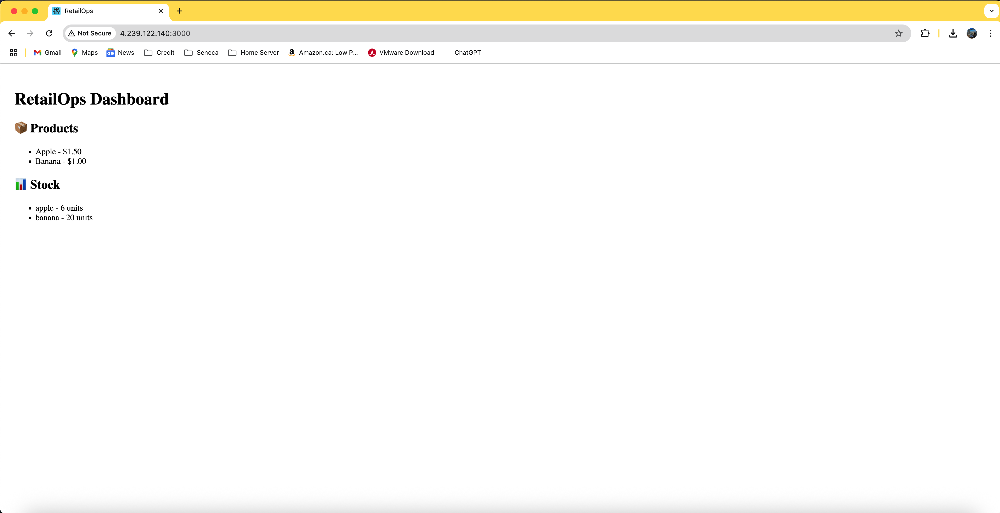 | **Containers running** 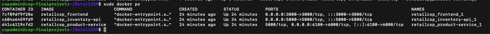 |
| **Products endpoint** 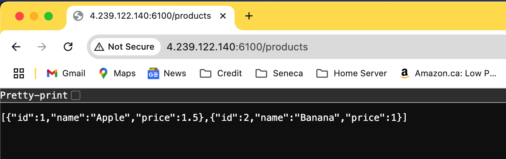 | **Stock endpoint** 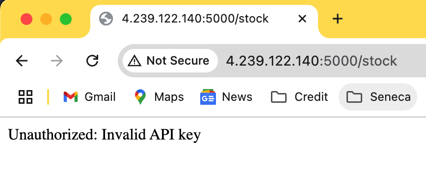 |
| **Update endpoint** 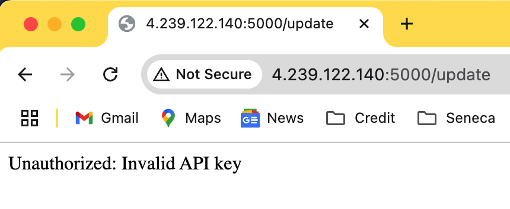 | **Endpoints from the terminal** 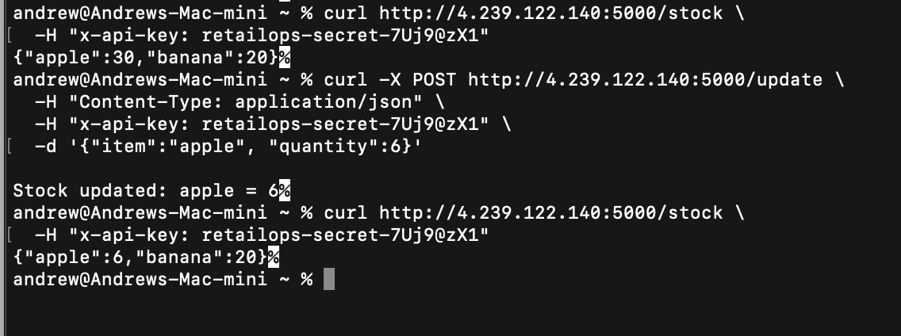 |
| **Queue Trigger log** 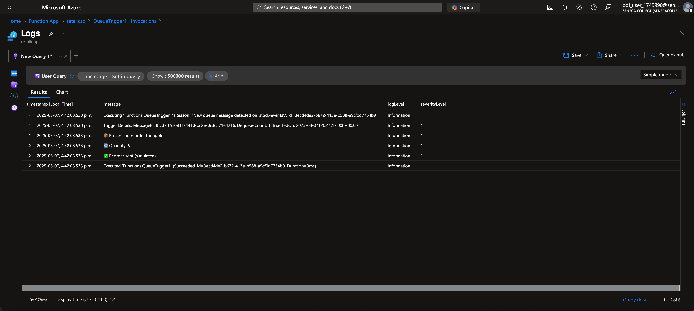 | **Queue Trigger invocations** 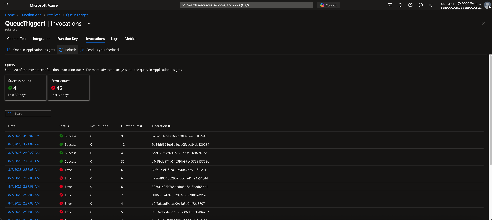 |
| **HTTP Trigger** 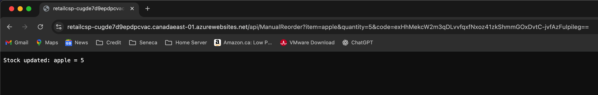 | **HTTP Trigger invocations** 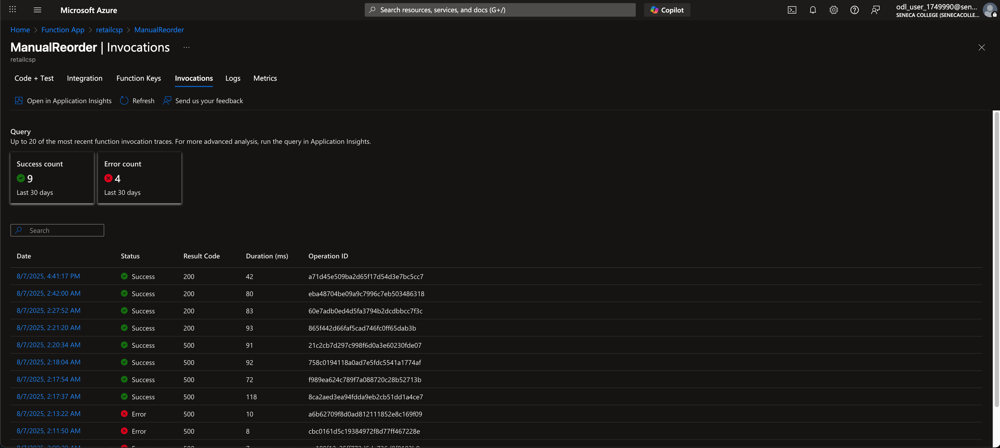 |
| **Timer Trigger log** 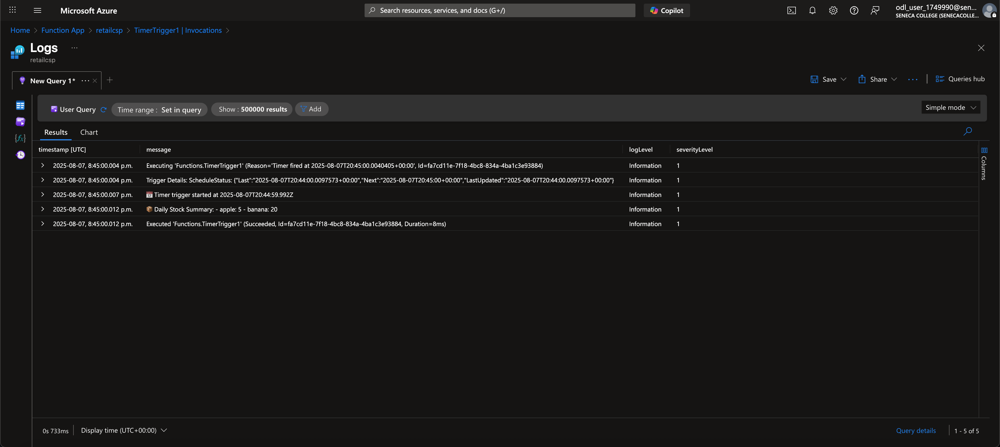 | **Timer Trigger invocations** 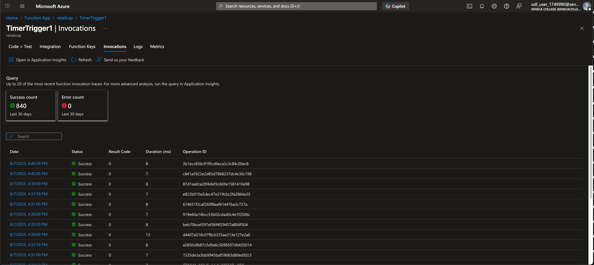 |
| **Application Insights** 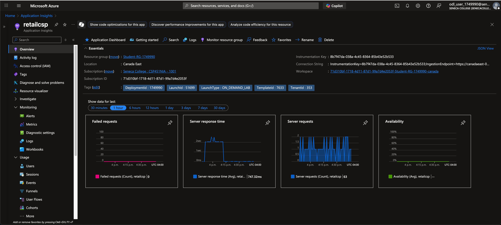 | |

---

## 🛣️ Possible next steps

- Reverse proxy (nginx / Caddy) with TLS and a custom domain
- Persist stock in a database (Azure Table Storage or Cosmos DB)
- Move secrets to Key Vault once policy allows it
- GitHub Actions pipeline for build, test and deploy
